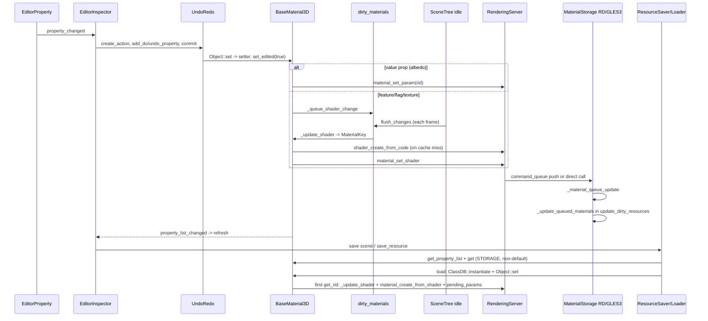

# Research: Data flow of editing material resources

**Date**: 2026-10-26T22:52:49+01:00
**Researcher**: Claude (Opus 5.5) for Hornster
**Git Commit**: `0f30f7d853` (working tree has uncommitted changes under `context/` only; no engine source is modified)
**Branch**: master
**Repository**: godot-tests (Godot Engine)

**Legend used throughout**: **[E]** evidence: observed at the cited `file:line` or in git output. **[I]** inference: a conclusion drawn from evidence, not observed directly. **[?]** unknown (white spot): the evidence could not show it; it is *not* a claim of absence.

## Research Question

Analyse the process of editing material resources, paying attention to the areas the repo map links to this functionality (`context/map/repo-map.md` zone 1 "Saving and loading scenes and resources", zone 2 "Look of materials, particles and environment", zone 3 "Picture on screen across GPUs"). Three parallel investigations:

1. **E2E trace**: entry point → layers → save/read → back, with steps, `file:line` and a Mermaid diagram.
2. **Test holes**: which methods and branches on that path are covered and which are not.
3. **Blast radius**: what must change together with a change in this flow (UI, generated layers, model, migrations, tests), joining the static graph with git co-change.

This describes the current state only. It contains no recommendations or plan.

## Summary

- **The flow has two data channels.** [E]
  - **Value edits** (for example `albedo_color`) go from the inspector, through UndoRedo and `Object::set`, to the bound setter. The setter calls `RS::material_set_param` immediately on the material's RID (`scene/resources/material.cpp:2162-2172`). ast-grep: 52 `_material_set_param` call sites, all funnelled through one `RS::material_set_param` at `:2164`.
  - **Shader-key edits** (features, flags, textures) put the material on a static `dirty_materials` list (`material.cpp:2150-2160`). ast-grep: 26 `_queue_shader_change()` call sites in 26 setters; `set_texture` (`:2556`) is the only function that uses both channels. A SceneTree idle callback flushes that list (`scene/register_scene_types.cpp:927`, `material.cpp:2134-2148`). The flush regenerates the shader text, looks it up in a refcounted global `shader_map`, and calls `material_set_shader` (`material.cpp:659-695, 2088-2113`).
  - Nodes and the editor preview hold the material **by RID**, not by object (`scene/3d/visual_instance_3d.cpp:223-231`). That shared RID is what keeps the viewport in sync.
- **Persistence is property reflection.** [E] On save, `PROPERTY_USAGE_STORAGE` properties are written unless they equal the ClassDB default (`scene/resources/resource_format_text.cpp:2059-2105`, `scene/property_utils.cpp:170-190`). On load, `ClassDB::instantiate` runs, then each value goes through the same `Object::set` (`resource_format_text.cpp:565-675`). The shader is built lazily on the first `get_rid()` (`material.cpp:3179-3183`). There is no format-version migration: renamed properties are remapped per class inside `_set`, under `#ifndef DISABLE_DEPRECATED` (`material.cpp:200-235, 4061-4158`).
- **Tests.** [E] No test in `tests/` references a concrete material class. Material-related assertions exist only in 3 glTF module test headers (`modules/gltf/tests/test_gltf_{images,emissive,extras}.h`). Only 2 of them assert StandardMaterial3D getters after an import or round trip: `emissive` (`get_feature`, `get_emission_operator`, `get_emission`) and `images` (the texture from `get_texture`). `extras` asserts only the Resource name and meta on a `Ref<Material>` (`:104-105`). Unit tests run on the dummy rendering server, whose `material_set_param`, `material_get_param`, `shader_get_code` and `shader_get_parameter_default` are stubs (`servers/rendering/dummy/storage/material_storage.h:100,105,123,124`). Not covered at all: the compatibility remaps, `_validate_property`, the shader-cache refcount, conversion to ShaderMaterial, CanvasItemMaterial, ParticleProcessMaterial, ORMMaterial3D and every editor material plugin.
- **Blast radius.** [E]
  - **Compile time:** 37 direct includers of `material.h`, 150 files within two hops (37 + 113 new; ast-grep include graph).
  - **No include edge:** the most expensive coupling is a *string* contract. Every render mode or built-in that `BaseMaterial3D::_update_shader` emits must exist in `shader_types.cpp`, both RD scene shaders and GLES3. Checked mechanically: today all 32 emitted render-mode literals are declared in `shader_types.cpp`. 31 of them are named in all three renderers; `diffuse_lambert` is the implicit default and is named in none.
  - **History agrees:** in 12 months, of 11 semantic `material.cpp` commits, 3 co-changed `drivers/gles3/storage/material_storage.cpp`, and only 1 co-changed `doc/classes/BaseMaterial3D.xml`. One of the three reverts in zone 2 (#115163) was a generated-shader fix made in `material.cpp` alone; its redo touched 9 files.
- **Debt hot spots** (Technical Debt section) [I]:
  - hand-kept duplicates (3 shader caches, 2 renderer storages, CPUParticles ↔ ParticleProcessMaterial, shader baker ↔ Sprite3D/Label3D)
  - silent compatibility paths (an unknown legacy name returns `true`; default-skip saving makes default changes silent migrations)
  - an untestable seam (the dummy RS).

---

## 1. Feature overview

### 1.1 What "a material resource" is here

| Class | Location | Shader source | Notes |
|---|---|---|---|
| `Material` (base) | `scene/resources/material.h:38` | — | `next_pass`, `render_priority`, `_mark_initialized` |
| `ShaderMaterial` | `material.h:95` | user `Shader` | parameters are dynamic `shader_parameter/<uniform>` properties |
| `BaseMaterial3D` → `StandardMaterial3D`, `ORMMaterial3D` | `material.h:140, 913, 926` | generated in `_update_shader` | the primary path of this analysis |
| `CanvasItemMaterial` | `scene/resources/canvas_item_material.h:35` | generated | its own dirty list, shader map and idle flush |
| `ParticleProcessMaterial` | `scene/resources/particle_process_material.h:46` | generated (`shader_type particles`) | its own dirty list, shader map and idle flush |
| `PlaceholderMaterial` | `material.h:933` | none | empty shader RID, no render path |

Registration: `scene/register_scene_types.cpp:459-460` (Material, Placeholder), `:803-808` (ShaderMaterial, CanvasItemMaterial, plus idle flush), `:893-895` (ParticleProcessMaterial), `:921-928` (BaseMaterial3D family, plus idle flush), `:1190, :1202` (compatibility classes `ParticlesMaterial` and `SpatialMaterial`). [E]

### 1.2 E2E sequence: BaseMaterial3D / StandardMaterial3D (primary path)

All steps are **[E]** unless tagged otherwise.

**A. Editor entry**

| # | Where | What happens |
|---|---|---|
| 1 | `editor/inspector/editor_properties.cpp:3716-3775` | `EditorPropertyResource::update_property` creates a nested sub-inspector and calls `sub_inspector->edit(res)`. A material held by a node (`material_override`, a surface override) is edited as its own Object. |
| 2 | `editor_properties.cpp:3445-3473` | `_select_resource`: unfolds in place or emits `resource_selected` (full-dock inspect). A built-in resource from a foreign scene goes to `EditorNode::edit_foreign_resource` through `call_deferred`. |
| 3 | `editor/scene/material_editor_plugin.cpp:452-470, 184-221` | `EditorInspectorPluginMaterial` adds the preview. `MaterialEditor::edit` puts the **same** material on the preview mesh with `set_material_override`, so the preview follows through the shared RID. |
| 4 | `editor/inspector/editor_inspector.cpp:322-328, 4274, 5878` | Widget → `EditorProperty::emit_changed` → `property_changed` → `EditorInspector::_property_changed` → `_edit_set`. |
| 5 | `editor_inspector.cpp:5730-5872` | `_edit_set` does the following: duplicates a foreign built-in (`:5742-5752`); `create_action("Set %s", MERGE_ENDS)`; adds `add_do_property` / `add_undo_property`; runs the inspector hook callbacks (`:5815-5826`); adds `update_node_reference` for every node sharing the resource (`:5838-5850`); handles a `resource_local_to_scene` toggle (`:5851-5860`); calls `commit_action`. |
| 6 | `material_editor_plugin.cpp:473-506` (registered `:516`) | Undo-redo hook: dropping a texture into an empty `roughness_texture` / `metallic_texture` slot also sets `roughness` / `metallic` to 1.0. It casts to `StandardMaterial3D`, so ORMMaterial3D is excluded. |
| 7 | `editor/editor_undo_redo_manager.cpp:63-103` | History choice: a built-in material (empty path or `scene::id`) uses that scene's history; a `.tres` material uses the global history. |
| 8 | `core/object/undo_redo.cpp:399-407` | `TYPE_PROPERTY`: `obj->set(name, value)`, then `res->set_edited(true)` (TOOLS_ENABLED). That flag drives saving later. |

**B. Model**

| # | Where | What happens |
|---|---|---|
| 9 | `core/object/object.cpp:198-262, 349-392` | `Object::set`: script → extension → `set_native` (bound setter from `get_gdtype().members()`, indexed setters pass the index) → fallback to the virtual `_set`. |
| 10 | `material.cpp:3638, 3634, 3658` | Binding: `albedo_color` → `set_albedo`. 58 `ADD_PROPERTYI` bindings pass an index: 25 to `set_flag`, 14 to `set_feature` and 19 to `set_texture`. |
| 11 | `material.cpp:2162-2172, 2116-2132` | **Value channel**: `set_albedo` → `_material_set_param` (52 call sites). If the RID exists it calls `RS::material_set_param` (`:2164`); otherwise the value goes to `pending_params`, replayed by `_check_material_rid` (`:2127`). |
| 12 | `material.cpp:2507-2534, 2541-2549, 2555-2569` | **Shader-key channel**: 26 setters call `_queue_shader_change`. 11 of them also call `notify_property_list_changed`; `set_flag` does, `set_feature` does not. `set_texture` (`:2556`) is the only function that does both: it sets the texture RID as a param and queues a shader change. |
| 13 | `material.cpp:2150-2160` | `_queue_shader_change`: **no-op until `_is_initialized()`**; otherwise it takes `material_mutex` and adds the material to the static `dirty_materials` SelfList. |
| 14 | `register_scene_types.cpp:927`; `scene/main/scene_tree.cpp:669, 740, 2029`; `material.cpp:2134-2148` | **Deferred**: `BaseMaterial3D::flush_changes` is a SceneTree idle callback run in both `physics_process` (`:640`, call at `:669`) and `process` (`:689`, call at `:740`). It copies the list under the lock, then calls `_update_shader` on each material outside it. |
| 15 | `material.cpp:659-695` | `_update_shader`: `_compute_key()`; returns if the key is unchanged. Under `shader_map_mutex` it decrements `users` on the old key (frees at 0). On a cache hit: `users++` and `material_set_shader`. |
| 16 | `material.cpp:697-2085, 2088-2113` | Cache miss: generates the shader code string. `RS::shader_create_from_code` runs **outside** the mutex (the comment cites WorkerThreadPool deadlocks), then re-locks. If another thread created the same key first, it frees its own shader. Then `users++` and `material_set_shader`. |
| 17 | `material.cpp:3179-3183` | `get_rid()` runs `_update_shader()` synchronously, then `_check_material_rid()` → `material_create_from_shader(next_pass, priority, shader)`. |
| 18 | `scene/3d/visual_instance_3d.cpp:223-231`; `scene/3d/mesh_instance_3d.cpp:375-383` | Nodes push **only the RID** to the RenderingServer (`instance_geometry_set_material_override` `:231`, `_overlay` `:240`, `instance_set_surface_override_material` `mesh_instance_3d.cpp:381`). Only `GeometryInstance3D::set_material_override` connects a signal, `property_list_changed` (`:225/:229`). `set_material_overlay` and `MeshInstance3D` surface overrides connect nothing. |
| 19 | `editor_inspector.cpp:5494, 6356, 5713-5727, 6285-6325` | `property_list_changed` → `_changed_callback` → pending refresh, rebuilt in `NOTIFICATION_PROCESS`. |

**C. Rendering server**

| # | Where | What happens |
|---|---|---|
| 20 | `servers/rendering/rendering_server.h:183-193`; `rendering_server_default.h:278-345`; `servers/server_wrap_mt_common.h:267-276` | Material API. `FUNC2` setters push to the render-thread `command_queue` when `ASYNC_COND_PUSH` holds, otherwise they call directly. `*_create_from_*` allocates the RID immediately. |
| 21 | `servers/rendering/renderer_rd/storage_rd/material_storage.cpp:2574-2591, 2445-2455` | RD `material_set_param`: rejects Object values (`ERR_FAIL_COND`), stores the param, then `_material_queue_update`. |
| 22 | `storage_rd/material_storage.cpp:2515-2563, 2603-2626` | RD `material_set_shader`: swaps `MaterialData`, registers the material in `shader->owners`, calls `changed_notify(DEPENDENCY_CHANGED_MATERIAL)`; next pass and render priority. |
| 23 | `storage_rd/material_storage.cpp:2457-2483`; `storage_rd/utilities.cpp:252-254`; `renderer_scene_cull.cpp:4391`; `renderer_canvas_cull.cpp:2566` | `_update_queued_materials` runs from `update_dirty_resources` → `update_parameters` (uniform buffer, uniform set). |
| 24 | `drivers/gles3/storage/material_storage.cpp:2533-2550, 2490, 2436, 2447`; `drivers/gles3/storage/utilities.cpp:405` | GLES3 twin of steps 21–23. |

**D. Save**

| # | Where | What happens |
|---|---|---|
| 25 | `editor/editor_node.cpp:2540-2599, 2434-2482` | Scene save: `pack` → `ResourceSaver::save(..., FLAG_REPLACE_SUBRESOURCE_PATHS)` → `_save_external_resources`, which saves edited external `.tres` resources found in `ResourceCache`. |
| 26 | `editor_node.cpp:1865-1889, 1810-1862` | Standalone `save_resource`: a built-in resource goes to `save_scene_if_open`; otherwise `save_resource_in_path` → `ResourceSaver::save`. |
| 27 | `scene/resources/resource_format_text.cpp:1614-1660, 2031-2056, 2059-2105`; `scene/property_utils.cpp:170-190` | Text: collect sub-resources, write `[sub_resource]` / `[resource]`, `set_edited(false)`. Each `PROPERTY_USAGE_STORAGE` property is written **unless it equals the ClassDB default**. |
| 28 | `core/io/resource_format_binary.cpp:2089, 2194-2218` | Binary `.res`: same STORAGE and default-skip rule. |

**E. Load (back)**

| # | Where | What happens |
|---|---|---|
| 29 | `resource_format_text.cpp:565-616`; `core/object/class_db.cpp:565-575`; `register_scene_types.cpp:1190, 1202` | `ClassDB::instantiate(type)`. Old class names (`SpatialMaterial`, `ParticlesMaterial`) resolve through compatibility classes. |
| 30 | `resource_format_text.cpp:619-675`; `resource_format_binary.cpp:808` | Each value goes through `res->set(name, value)`, the same path as step 9, including the legacy `_set` remaps. |
| 31 | `material.cpp:3965-3988, 660-662` | While uninitialized, `_queue_shader_change` is a no-op and values sit in `pending_params`. The first `get_rid()` (step 17) marks the material ready and builds or looks up the shader synchronously, possibly on a loader thread. |
| 32 | `core/io/resource.cpp:49-60` | `Resource::emit_changed`: deferred if blocked; routed through `ResourceLoader::resource_changed_emit` on a loader thread. |

### 1.3 Diagram

### 1.4 Side branches

- **ShaderMaterial parameters** [E]
  - `_get_property_list` (`material.cpp:250-358`) builds `shader_parameter/<uniform>` entries from the shader's uniform list. It fills `param_cache` and `remap_cache` from `RS::shader_get_parameter_default`, and runs a deprecated PackedFloat32Array → PackedVector4Array conversion (`:317-330`).
  - An inspector set misses `set_native` and lands in `ShaderMaterial::_set` (`:200-235`), then `set_shader_parameter` (`:422-454`). Objects are turned into RIDs before `material_set_param` (`RID tex_rid = p_value;` at `:440`).
  - The whole body of `_set` sits under `if (shader.is_valid())` (`:201`). All four prefix checks are behind that guard, the current `shader_parameter/` (`:208`) as well as the legacy ones (`:216-220`). So any `shader_parameter/*` set that arrives before a valid shader returns `false`.
  - Revert values come from the shader defaults (`:362-385`).
  - `set_shader` (`:390-416`) connects `shader->changed` → `_shader_changed`, and calls `emit_changed()` at `:415`, the only `emit_changed` call in `material.cpp` (grep).
  - The ShaderMaterial RID is lazy (`_check_material_rid`, `:468-492`).
- **Conversion to ShaderMaterial** [E]
  - `EditorResourcePicker` builds a menu from the conversion plugins (`editor/inspector/editor_resource_picker.cpp:416-422, 606-615`). The chosen conversion becomes an undoable property swap on the owner through step 5. 9 material conversion plugins are registered with `resource_conversion_plugins.push_back` at `editor/editor_node.cpp:9631-9663`: CanvasItem, Blit, ParticleProcess, Standard, ORM, 3 sky materials and Fog. A 10th plugin, `VisualShaderConversionPlugin`, is registered from `modules/visual_shader/register_types.cpp:54`.
  - `MaterialEditor::make_shader_material` (`material_editor_plugin.cpp:57-84`) copies `RS::shader_get_code` (`:66`), `get_shader_parameter_list` (`:72`) and `material_get_param` (`:75`). Standard/ORM conversion lives in `editor/scene/3d/material_3d_conversion_plugins.cpp:47-69, 80-…`; CanvasItem, ParticleProcess and Blit conversion in `material_editor_plugin.cpp:525-588`.
- **Compatibility remaps on load** [E]
  - `StandardMaterial3D::_set` (`material.cpp:4061-4158`, "Kept for compatibility from 3.x to 4.0"): semantic mappings first, then a `remaps[]` table (`:4108-4142`, 29 entries plus a `nullptr` sentinel) and its lookup loop (`:4144-4151`), then `WARN_PRINT` + `return true` for an unknown name (`:4153-4154`).
  - `ShaderMaterial::_set` maps `param/`, `shader_param/`, `shader_uniform/` → `shader_parameter/` (`:214-231`).
  - BILLBOARD_PARTICLES compatibility is at `:743-745` and `:2600-2609`.
- **next_pass / render_priority** [E]
  - `Material::set_next_pass` (`material.cpp:48-67`) rejects cycles and forces the child's RID.
  - `set_render_priority` (`:73-82`).
  - BaseMaterial3D's stencil code manages its own next pass (`:3186-3230`).
- **local_to_scene** [E]: no material class overrides `setup_local_to_scene` (0 hits from ast-grep and from grep across `scene/resources/*material*`). Duplication is generic (`scene/resources/packed_scene.cpp:200, 724-726, 784-793`).
- **CanvasItemMaterial / ParticleProcessMaterial differences** [E]
  - Each has its own static `dirty_materials`, `shader_map` and idle `flush_changes` (`register_scene_types.cpp:807, 894`), and creates its RID eagerly with `material_create()` (`canvas_item_material.cpp:284`, `particle_process_material.cpp:2759`).
  - Only CanvasItemMaterial calls `Material::_mark_initialized` (`canvas_item_material.cpp:292` → `material.cpp:104-124`, deferred via `call_deferred` during load). BaseMaterial3D (`material.cpp:661`) and ParticleProcessMaterial (`particle_process_material.cpp:162`) instead call `_mark_ready()` directly at the top of their own `_update_shader`.
  - CanvasItemMaterial (`canvas_item_material.cpp:153-160`, `material_mutex`) **and** ParticleProcessMaterial (`particle_process_material.cpp:1386-1393`, `dirty_materials_mutex`) hold the lock for the whole flush, including `_update_shader`. Only BaseMaterial3D copies the list under the lock and updates outside it.
  - ParticleProcessMaterial setters call `RenderingServer::get_singleton()->material_set_param` directly. That is 94 call sites in 48 functions, the first at `particle_process_material.cpp:1413`. The code spells it `RenderingServer::`, not `RS::`. 18 PPM functions call `_queue_shader_change`.
  - The particle min/max inspector editor emits `Vector2` values (`editor/scene/particle_process_material_editor_plugin.cpp:231-235`).

### 1.5 Test coverage on this path

| Method / branch | Status | Evidence |
|---|---|---|
| `Material::set_next_pass`, `set_render_priority`, `_validate_property`, `inspect_native_shader_code` (`material.cpp:48-157`) | Not covered | — |
| Base `Material` object identity only | Incidental | `tests/scene/test_sky.cpp:79-139, 197-210`, `tests/scene/test_arraymesh.cpp:262-289` |
| `ShaderMaterial::_set` / `_get` / `_get_property_list` / revert / `set_shader` / `set_shader_parameter` / legacy prefix remaps (`material.cpp:200-492`) | Not covered | 0 references in `tests/` or `modules/*/tests` |
| BaseMaterial3D `set_texture`, `set_albedo`, `set_feature`, `set_emission_operator` | Incidental (glTF setup/import) | `modules/gltf/tests/test_gltf_images.h:79-81`, `test_gltf_extras.h:53-58`; `modules/gltf/gltf_document.cpp:2973-3189` |
| `get_texture`, `get_feature`, `get_emission_operator`, `get_emission` | Asserted after a glTF round trip | `test_gltf_images.h:47-57` (`get_texture` at `:48`, CHECKs on the texture at `:50-57`), `test_gltf_emissive.h:48-60` (CHECKs `:52, :55, :58-60`) |
| `Ref<Material>` name / meta after a glTF round trip | Asserted, base Resource API only | `test_gltf_extras.h:104-105` |
| 152 other BaseMaterial3D setters and getters (160 `set_`/`get_`/`is_` definitions in `material.cpp`, 156 of them in `:2179-3366`) | Not covered | — |
| `_queue_shader_change` / `flush_changes` | Not covered [I] | no test drives SceneTree idle with a live material |
| `_update_shader` code generation, `shader_map` insert/release, destructor release (`material.cpp:659-2113, 4039-4056`) | Executed, never asserted [I] | reached via `get_rid()` from `PrimitiveMesh::set_material` / `ArrayMesh::surface_set_material` in glTF tests; a dummy-compiler error only prints |
| `_validate_property` (`material.cpp:2595-2782`), BILLBOARD_PARTICLES compatibility, `StandardMaterial3D::_set` 3.x remaps, `get_material_for_2d`, stencil next pass | Not covered | — |
| `SpatialMaterial` / `ParticlesMaterial` compatibility classes | No unit test; CI `--validate-conversion-3to4` checks text renames only | `.github/workflows/linux_builds.yml` (godot-converter-test) |
| ORMMaterial3D, PlaceholderMaterial, CanvasItemMaterial, ParticleProcessMaterial (all of it) | Not covered | 0 references |
| Editor: `make_shader_material`, conversion plugins, undo-redo hook, preview, particle MinMax editor | Not covered | no editor material tests |
| Binary save/load of StandardMaterial3D | Incidental | glTF import saves and reloads `.scn` (`modules/gltf/tests/test_gltf.h:96-102`) |
| Text `.tres` save/load of any material | Not covered for materials | only base `Resource` (`tests/core/io/test_resource.cpp:530-572`) |
| RD and GLES3 `MaterialStorage` | No unit test | only the CI project smoke import (fails on crash/ASan/leak: `misc/scripts/check_ci_log.py:19-51`) |

**Test-infrastructure limits** [E]

- Unit tests use the dummy renderer (`main/main.cpp:771-773`; `tests/display_server_mock.cpp:77-79`).
- In the dummy storage, `material_set_param` and `material_set_render_priority` are no-ops, while `material_get_param`, `shader_get_parameter_default` and `shader_get_code` return empty values (`servers/rendering/dummy/storage/material_storage.h:100, 105, 120, 123, 124`). The header holds 26 such trivial stubs. The dummy `.cpp` does implement `shader_set_code` (`:161`), `get_shader_parameter_list` (`:195`), `material_set_shader` (`:248`) and `material_set_next_pass` (`:255`). So a test *can* observe ShaderMaterial's uniform property list, but not parameter values.
- Engine errors don't fail a test unless the opt-in `ErrorDetector` (`tests/test_tools.h:35`) is used. It is used in 3 test files (`tests/scene/test_theme.cpp` 14×, `tests/core/variant/test_array.cpp:304`, `tests/core/test_validate_testing.cpp:194`), none of them material-related.
- Module tests are picked up only from `modules/*/tests/*.h` (`modules/SCsub:48`). So `modules/visual_shader/tests/test_visual_shader.cpp` is not compiled: the visual_shader SCsub adds `*.cpp`, `vs_nodes/*.cpp` and `editor/*.cpp` only (`modules/visual_shader/SCsub:11-15`).
- glTF tests compile only with TOOLS_ENABLED.

**History** [E]

- `git log --since=2025-10-22 -- tests/` matching material or shader shows b289b6f4ed (unrelated rd_glsl fixture) and cfded120ae (moved `test_visual_shader.cpp` out of the compiled set).
- The only material-asserting test added in 12 months is 5d9f5c54ef (`modules/gltf/tests/test_gltf_emissive.h`).
- The worker checked 10 of about 40 material commits in the window (including 428098a711, 227b015974, fd3541edb4/5c662e7d47, ba5a0758e9, 6c88ec6c57, f0fa171ec2/aac883849e, 88dbf5a584). None touches `tests/`.

### 1.6 Blast radius

**Static graph** [E]

| Header | Direct includers | By layer |
|---|---|---|
| `scene/resources/material.h` | 37 | scene 22, editor 8, modules 6, servers 1 |
| `canvas_item_material.h` | 4 | scene 3, editor 1 |
| `particle_process_material.h` | 10 | scene 5, editor 5 |

- Direct counts exclude each class's own relative self-include (`material.cpp:31` and the matching lines in the other two `.cpp` files). 22 of the 37 direct includers are headers.
- Two hops out from `material.h`: 150 files in total (the 37 direct includers plus 113 new ones; scene 65, editor 49, modules 24, tests 6, servers 4, main 2). `scene/resources/mesh.h` is the largest single conduit, bringing in 45 of the 113 new files. That is about 40%, not a majority, so "mostly through mesh.h" overstated it.
- **Backward edge:** `servers/navigation_3d/navigation_server_3d.h:36` includes `scene/resources/material.h` (no guard; also in `context/map/evidence/structure/upward.json:885`).
- No file in `core/`, `drivers/` or `platform/` includes a `scene/resources` material header. The only `*material*.h` includes there are renderer-internal `*material_storage.h` headers. The renderers are coupled through RIDs and shader **text** only.

**Coupling with no include edge** [E, with the "must change" reading being I]

- **Generated-shader string contract.** A render mode emitted by `material.cpp` (for example at `:875, :878`) must also exist in:
  - `servers/rendering/shader_types.cpp` (e.g. `:243, :262, :263`)
  - `renderer_rd/forward_clustered/scene_shader_forward_clustered.cpp`
  - `renderer_rd/forward_mobile/scene_shader_forward_mobile.cpp`
  - `drivers/gles3/storage/material_storage.cpp` (plus the matching `.glsl` files)

  Particles add `particles_storage` and `particles*.glsl`; canvas adds `renderer_canvas_render_rd.cpp` and both `canvas.glsl` files.

  Mechanical check (ast-grep, string literals only, so comments are excluded): `BaseMaterial3D::_update_shader` emits 32 distinct render-mode literals (`code += ", <mode>"`, after `:753`). All 32 are declared in `shader_types.cpp` spatial modes. 31 are named in `scene_shader_forward_clustered.cpp`, `scene_shader_forward_mobile.cpp` and GLES3 `material_storage.cpp`. `diffuse_lambert` is named in none of the three; it is the implicit default. The contract holds today; nothing enforces it.
- **Uniform names = conversion parameter names.** `material_editor_plugin.cpp:66-76, 571-582` and `material_3d_conversion_plugins.cpp:55-65, 88-98` copy the generated uniforms into a ShaderMaterial.
- **Hand-copied logic.** `editor/export/shader_baker/shader_baker_export_plugin.cpp:312` ("These must match the defaults set by Sprite3D/Label3D") and `:333` ("This must follow the logic in Sprite3D::draw_texture_rect()"). The two sides already differ in call shape. The baker calls `StandardMaterial3D::get_material_for_2d` with 10 arguments (`:349, :354`); Sprite3D (`sprite_3d.cpp:303`) and Label3D (`label_3d.cpp:398`) pass 12. The baker leaves `p_texture_repeat` at its default `false` (`material.h:880`), while Sprite3D passes its real `texture_repeat`. [I] A Sprite3D with texture repeat on may need a shader variant that the baker does not pre-build.
- **Particle mirrors.** CPUParticles2D/3D re-implement ParticleProcessMaterial (`scene/2d/cpu_particles_2d.cpp:1400-1470`).
- **Strings in editor plugins.** `material_editor_plugin.cpp:479-500` (`"roughness_texture"` …) and `particle_process_material_editor_plugin.cpp:449-451` (range-hint format).
- **Resource-type hint strings.** `"BaseMaterial3D,ShaderMaterial"` appears 11 times in **5** `.cpp` files: `modules/csg/csg_shape.cpp` 6× (`:1471, 1646, 1816, 2024, 2249, 2794`), `scene/3d/visual_instance_3d.cpp:621-622`, `scene/3d/mesh_instance_3d.cpp:115`, `scene/resources/mesh.cpp:1793` and `scene/resources/3d/primitive_meshes.cpp:261`. Siblings: `"CanvasItemMaterial,ShaderMaterial"` 3×, `"ParticleProcessMaterial,ShaderMaterial"` 2×, plus 1 sky and 1 fog variant. They flow into `extension_api.json` (precedent: `misc/extension_api_validation/4.2-stable_4.3-stable/GH-81996.txt`).

**Generated / CI-enforced layers** [E]

| Layer | Kind | Enforcement |
|---|---|---|
| `doc/classes/{BaseMaterial3D,ParticleProcessMaterial,CanvasItemMaterial,ShaderMaterial,Material,…}.xml` | skeleton and `default=` regenerated; descriptions written by hand | `--doctool` + diff in CI (`.github/workflows/linux_builds.yml:251-257`) |
| `misc/extension_api_validation/<from>_<to>/GH-<PR>.txt` | manual, written when the API breaks | `validate_extension_api.sh` in CI (`linux_builds.yml:260-270`); material precedents GH-79527, GH-81996 |
| `*.compat.inc` for materials | **none exist**: 0 of the 79 `*.compat.inc` files in the repo (pattern: `scene/resources/shader.compat.inc:37-47`) | manual |
| C# glue (`modules/mono/glue/GodotSharp/*/Generated`) | regenerated, gitignored | reach [?] |
| `editor/icons/*Material*.svg` | manual, new class only | `editor/icons/SCsub:11` glob |
| Inspector name remaps (`editor/inspector/editor_property_name_processor.cpp`), `.po` translations | manual remaps; `.po` extracted later | — |

**Co-change (git, 2025-10-22 → HEAD, `--no-merges`, bulk >50-file and `Style:`/thirdparty commits excluded)** [E]

- `material.cpp` had 21 commits: 7 bulk excluded, 14 kept. Of those, 11 are semantic (3 mechanical refactors of 15–47 files also left out).

| Co-changed with `material.cpp` (n = 11 semantic) | Count | P(other \| material.cpp) |
|---|---|---|
| `drivers/gles3/storage/material_storage.cpp` | 3 | 0.27 |
| `servers/rendering/shader_types.cpp` | 2 | 0.18 |
| `renderer_rd/forward_{clustered,mobile}/scene_shader_forward_*.cpp` (each) | 2 | 0.18 |
| `renderer_rd/shaders/forward_{clustered,mobile}/scene_forward_*.glsl` (each) | 2 | 0.18 |
| `drivers/gles3/shaders/scene.glsl` | 2 | 0.18 |
| `scene/resources/material.h` | 2 | 0.18 |
| `doc/classes/BaseMaterial3D.xml` | 1 | 0.09 |

- 6 of those 11 commits touch `material.cpp` alone: 428098a711, 5c662e7d47 (revert), fd3541edb4, 7f66e84840, 6c88ec6c57, f0fa171ec2 (revert). I verified each with `git show --name-only`.
- `particle_process_material.cpp`: 16 commits, 11 kept, 10 semantic. Co-changes: `particle_process_material.h` 4 (0.40), `doc/classes/ParticleProcessMaterial.xml` 4 (0.40), `scene/3d/cpu_particles_3d.cpp` 3 (0.30), `scene/2d/cpu_particles_2d.cpp` 3 (0.30). One outlier, 113ace0cd3 (GPUParticles3D billboarding), touched 19 files across the RS API and three particle storages.
- The editor plugin `material_editor_plugin.cpp` (6 kept commits) co-changes with editor UI (`editor_node.cpp` 3, `material_editor_plugin.h` 3), not with material resources.

**Reverts and regressions referenced by the repo map** [E]

| Merge | Content | Files | Reading |
|---|---|---|---|
| #115163 | f0fa171ec2 reverts the FLAG_FIXED_SIZE stereo fix | `material.cpp` only (4 lines, around `:1357-1370`) | its redo aac883849e touched 9 files (`shader_types.cpp`, both RD scene shaders and GLSL, GLES3 `scene.glsl` + material_storage, `visual_shader.cpp`) |
| #116140 | ba5a0758e9 reverts the `_adjust_curve_range` change to [-1, 1] | `particle_process_material.cpp`, `cpu_particles_2d.cpp`, `cpu_particles_3d.cpp` | the three-file set held for the change, the revert and the follow-up 227b015974 |
| #118373 | 5c662e7d47 reverts fd3541edb4 (`RS::material_set_param(..., default_value)` in ShaderMaterial) | `material.cpp`, 1 line | a runtime-semantics change made in one line |
| #110077 → #112471 | Environment glow default regression and fix (802eb0b1a0) | `environment.h`, `servers/rendering/storage/environment_storage.h`, `drivers/gles3/effects/glow.h`, `drivers/gles3/rasterizer_scene_gles3.cpp`, `doc/classes/Environment.xml` | **an environment regression, not a material one**; it shows the same pattern: one default copied into 4 code places plus the doc |

**Change-together checklist** (M = manual, R = regenerated or CI-checked) [E for each file location; I for "must"]

| Change | Must touch |
|---|---|
| New BaseMaterial3D property | M: `material.h` (member, accessors; enum + `*_MAX` + `MaterialKey` bits at `material.h:361-393` if it is a feature or flag. ast-grep counts 14 features (`:209-225`) and 25 flags (`:256-283`), packed into `uint32_t feature_mask` / `uint32_t flags` (`:392-393`), which leaves 18 feature bits and 7 flag bits [E]); `material.cpp` (`_bind_methods` from `:3379`, constructor default from `:3965`, `shader_names` `:563-650`, emission in `_update_shader`, `_validate_property` `:2595`); doc description; name remap if it is an acronym. Check: glTF `_parse_/_serialize_materials` (`gltf_document.cpp:2973, 2678`), fbx, obj importers. R: doc XML skeleton (CI fails without it), C# glue, `.po`. |
| Rename / removal | Everything above, plus a legacy entry in `StandardMaterial3D::_set` / `remaps[]` (`material.cpp:4108`) under `DISABLE_DEPRECATED`. If a bound method changes: a new `material.compat.inc` plus `misc/extension_api_validation/.../GH-<PR>.txt`. A renamed *generated uniform* breaks already-converted ShaderMaterials, which hold the old `shader_parameter/<name>`; no remap exists for that [I]. |
| Default-value change | Constructor default; doc `default=` (R, CI-enforced); CPUParticles2D/3D mirrors for particles; any copy in renderer storage (Environment precedent); `shader_baker_export_plugin.cpp:312` for Sprite3D/Label3D-related values. Saved files that left out the old default **change behaviour silently on load** [I, from step 27]. |
| New shader feature / render mode | `material.cpp` `_update_shader`; `shader_types.cpp`; both `scene_shader_forward_*.cpp` + `.glsl`; GLES3 `material_storage.cpp` + `scene.glsl`; `visual_shader.cpp` / `modules/visual_shader/vs_nodes/*` if the built-in is exposed. Precedents: aac883849e (9 files), 113ace0cd3 (19 files). |
| New material class | Header/cpp; register, idle-flush and init/finish hooks in `register_scene_types.cpp`; doc XML (CI fails if missing); icon; conversion plugin; inspector plugin `can_handle`; the 11 hint-string occurrences (5 files) → `extension_api.json` + `GH-<PR>.txt` (precedent GH-81996). |

---

## 2. Technical Debt

Each item: what it is, its evidence, and what follows. The "Consequence" column is **inference** unless it says otherwise.

| # | Debt | Evidence [E] | Consequence [I] |
|---|---|---|---|
| D1 | **Three copies of the "generated shader + global shader_map + idle flush" pattern** with different locking and init semantics | BaseMaterial3D `material.cpp:2134-2160, 659-2113` (flush outside the lock; `shader_create_from_code` `:2091`, `shader_map.insert` + `users++` `:2105-2109`; `_mark_ready` `:661`). ParticleProcessMaterial `particle_process_material.cpp:160-190, 1363-1381, 1386-1405, 2759` (the same cache shape as BaseMaterial3D, `_mark_ready` `:162`, **but** it holds `dirty_materials_mutex` during flush, and its RID is eager). CanvasItemMaterial `canvas_item_material.cpp:58-172` (the odd one out: `shader_create()` + `users = 1` `:143-148`, holds `material_mutex` during flush, eager RID, the only `_mark_initialized` caller). | A fix to cache, refcount or threading in one copy does not reach the others; the behaviour differs at load time (deferred vs lazy init). |
| D2 | **Generated-shader string contract with no compile-time or test check**, across `shader_types.cpp`, RD Forward+, RD Mobile and GLES3 | §1.6; co-change P = 0.27 / 0.18; revert #115163 (fix in `material.cpp` alone) and redo aac883849e (9 files); 428098a711 (duplicate `ndc` variable with refraction + proximity fade, `material.cpp:1808`) | Feature combinations can produce shaders that don't compile in a single renderer. Nothing catches it before a user does. |
| D3 | **Two hand-kept renderer storages** for the same material API, **already drifting** | ast-grep function-body diff of RD `storage_rd/material_storage.cpp` against GLES3 `drivers/gles3/storage/material_storage.cpp`. `material_set_param` (`2574-2591` / `2533-2550`), `material_get_param` and `material_set_next_pass` match line for line except the `GLES3::` qualifier. `material_set_shader` (`2515-2563` / `2490-2531`): RD takes `shader->mutex` around `owners.erase` and registration, GLES3 takes no lock. `material_set_render_priority` (`2619-2627` / `2578-2589`): GLES3 range-checks the priority, RD does not. Repo-map zone 3. | Each material change must be made 2–3 times; drift is only caught visually. The lock and validation gaps are such drift [I: whether GLES3 needs the lock depends on its threading model, not inspected]. |
| D4 | **Silent compatibility on load** | `StandardMaterial3D::_set` returns `true` with only `WARN_PRINT` for an unknown legacy name (`material.cpp:4153-4154`); `remaps[]` has a self-mapping entry `{"params_depth_draw_mode","params_depth_draw_mode"}` (`:4121`), already handled semantically at `:4094`, and a duplicated `flags_use_shadow_to_opacity` entry (`:4109-4110`); the whole of `ShaderMaterial::_set`, current `shader_parameter/` and legacy prefixes alike, runs only when `shader.is_valid()` (`:201-233`). ParticleProcessMaterial and CanvasItemMaterial have no `DISABLE_DEPRECATED` block and no `_set` override (ast-grep + grep: 0; `material.cpp` has 5 such blocks, `:214, 317, 743, 2600, 4061`). | A wrong or removed name is swallowed instead of failing. ShaderMaterial parameter loading, not only migration, depends on the property order in the file [?]. Particle/canvas semantic changes have no migration path at all. |
| D5 | **Default-skip serialization turns default changes into silent migrations** | `resource_format_text.cpp:2059-2105`, `property_utils.cpp:170-190`, binary `:2194-2218`; the format version has not changed in 12 months and has never been used for material migration (worker: `git log -G FORMAT_VERSION` empty); #116140 revert | Changing a constructor default changes every saved material that relied on it, with no warning. CI `--doctool` catches the doc diff, not the behavioural change. |
| D6 | **State-dependent STORAGE flags** | `BaseMaterial3D::_validate_property` (`material.cpp:2595-2781`) rewrites `p_property.usage` 40 times: 23× `PROPERTY_USAGE_NONE` (drops STORAGE), 16× `NO_EDITOR` (keeps STORAGE, editor-only gating), 1× `DEFAULT`. The NONE triggers are transparency and alpha AA (`:2664-2682`), `deep_parallax` (`:2686`), `FLAG_SUBSURFACE_MODE_SKIN` (`:2712`), ORM (`:2721, 2726`), shading mode (`:2734-2778`), `billboard_mode` for `particles_anim_*` (`:2604`), and the **project setting** `use_physical_light_units` for `emission_intensity` (`:2597`) | What gets written to disk depends on other properties' current values and, for `emission_intensity`, on ProjectSettings. Untested. |
| D7 | **Test seam: the dummy RS makes the value channel unobservable** | `servers/rendering/dummy/storage/material_storage.h:100, 105, 120, 123, 124`; no global `ErrorDetector` (`tests/test_tools.h:35`) | ShaderMaterial revert, conversion (`make_shader_material`) and param propagation cannot be tested as the harness stands; shader compile errors don't fail tests. |
| D8 | **Test holes on the whole path** | §1.5: 0 references to concrete material classes in `tests/`; material assertions only in 3 glTF headers; no material-related test change in 10 inspected material commits over 12 months; `test_visual_shader.cpp` not compiled (`modules/SCsub:48`, `modules/visual_shader/SCsub:11-15`) | Changes in repo-map risk zone 2 are verified by hand; reverts are the feedback loop. |
| D9 | **CPUParticles ↔ ParticleProcessMaterial parity by hand, already drifting** | `particle_process_material.h:73` `ParticleFlags` has 6 flags (adds DAMPING_AS_FRICTION, INHERIT_EMITTER_SCALE, PRESERVE_COLOR); `scene/3d/cpu_particles_3d.h:68` and `scene/2d/cpu_particles_2d.h:65` have 3 each; P(cpu_particles_3d \| PPM) = 0.30 | Particle changes need 3 files; a feature gap may be intentional [?]. |
| D10 | **Hand-copied logic in the shader baker** | `editor/export/shader_baker/shader_baker_export_plugin.cpp:312, 333` (comments "must match" Sprite3D/Label3D). The call shapes already differ: the baker passes 10 arguments to `get_material_for_2d` (`:349, :354`), Sprite3D and Label3D pass 12 (`sprite_3d.cpp:303`, `label_3d.cpp:398`), and `p_texture_repeat` is left at its default | Changes to `get_material_for_2d` / Sprite3D defaults can silently break exported shader caches. A texture-repeat Sprite3D variant is possibly not pre-baked today [I]. |
| D11 | **Value edits don't emit `changed` on BaseMaterial3D** | The only `emit_changed()` in `material.cpp` is at `:415` (`ShaderMaterial::set_shader`), checked with ast-grep for the bare, `->`, `.` and `emit_signal` forms. Only `GeometryInstance3D::set_material_override` connects anything, and that is `property_list_changed` (`visual_instance_3d.cpp:225/229`). No `connect_changed` or `connect(CoreStringName(changed))` on a rendering material exists in `scene/`, `editor/` or `modules/` (only on PhysicsMaterial) | Sync relies only on the shared RID. Listeners on `Material.changed` would miss value edits; no direct listener was found, but generic Resource listeners (e.g. thumbnails) are still [?]. |
| D12 | **String-keyed coupling in editor plugins** | `material_editor_plugin.cpp:483-500` (8 string literals: `"roughness_texture"`, `"roughness"`, `"metallic_texture"`, `"metallic"`), `:479` `cast_to<StandardMaterial3D>` (so ORM is excluded); `particle_process_material_editor_plugin.cpp:449-451` (range-hint format) | A property rename doesn't fail to compile; the editor behaviour quietly stops. |
| D13 | **Backward include servers → scene** | `servers/navigation_3d/navigation_server_3d.h:36` (unguarded; 15 `Ref<StandardMaterial3D>` debug-material fields plus 15 getters, `:398-521`) | Part of the cycle in repo-map §3; `material.h` changes recompile navigation server consumers (29 full-path includers, plus the relative includes in its own `.cpp` and `.compat.inc`). |
| D14 | **MaterialKey bit budget** | `material.h:361-393`: mode fields are `uint64_t` bitfields sized by `Math::get_num_bits(*_MAX - 1)` (`:361-389`), and features and flags are two `uint32_t` masks (`:392-393`). ast-grep enum count: 14 features, 25 flags | 7 flag bits and 18 feature bits remain [E]; adding more than 7 flags needs a key layout change [I]. |

---

## 3. Evidence, inference, unknowns (consolidated)

**Evidence** (all anchored above; the decisive ones were re-read by me after the workers):

- `material.cpp:2150-2172` (the two channels)
- `register_scene_types.cpp:807, 894, 927` (three idle flushes)
- `material.cpp:415` (single `emit_changed`)
- `material.cpp:3179-3183` (lazy `get_rid`)
- `core/object/undo_redo.cpp:399-407` (`set_edited`)
- `material.cpp:2088-2095` (shader creation outside the mutex)
- `material.cpp:4092-4158` (legacy remaps, self-map, duplicate, `return true`)
- dummy storage `material_storage.h:100-124`
- `modules/SCsub:44-50` and `modules/visual_shader/SCsub:11-15`
- `navigation_server_3d.h:36`
- `shader_baker_export_plugin.cpp:312, 333`
- the PPM vs CPUParticles3D flag enums
- the 6 single-file commits
- `linux_builds.yml:251-257`

**Inference**:

- Feature and flag edits reach the screen about one frame later (idle flush + `update_dirty_resources`). Value edits skip the dirty list but still go through the RS command queue.
- Loaded materials compile lazily, possibly on loader threads.
- Dynamic `shader_parameter/*` entries have no ClassDB default, so the saver's default-skip likely never applies to them.
- The `must change together` sets are inferred from string identity plus co-change; nothing enforces them.
- Most `material.cpp` commits change shader text or editor behaviour rather than the API: only 1 of 11 touched `BaseMaterial3D.xml`.
- Undo for a `.tres` material lands in the global history; for an embedded one, in the scene history.

**Unknowns (white spots)**:

- Runtime wiring through ClassDB, `Callable`, signals and `get`/`set` strings has no static graph. The string matches listed are a sample, not a complete set.
- Which thread runs `flush_changes` relative to RS command execution in each render-thread mode (`ASYNC_COND_PUSH`).
- Whether ShaderMaterial `shader_parameter/*` lines are always written after `shader` (the load-order dependency in D4).
- How `PROPERTY_USAGE` is assigned to shader uniforms in `get_shader_parameter_list` (RD/GLES3), and so whether default-valued parameters are saved.
- Whether the inspector thumbnail regenerates for StandardMaterial3D value edits.
- The `_compute_key` body and the code-generation detail (`material.cpp:710-2080` not inspected; the `MaterialKey` *field* layout is now known, see D14, and the emitted render-mode literals were enumerated, see §1.6).
- `SceneState::pack` filtering for node-level material overrides; `Mesh::surface_set_material` RID re-push.
- The `update_parameters` internals. (The GLES3 `material_set_shader` body is now compared with RD, see D3.)
- Whether GLES3 needs the `shader->mutex` that RD takes in `material_set_shader` (D3).
- The reach of the generated C# API (gitignored). Third-party GDExtensions and user files that use legacy names.
- Which materials the external CI regression and export projects contain, so how much real RD/GLES3 material code CI exercises.
- Actual runtime line coverage (nothing was built or run).
- Whether the CPUParticles flag gap is intentional.
- In-flight PRs touching materials (not collected).

## Code References

- `scene/resources/material.cpp:200-235` - ShaderMaterial `_set` + legacy prefix remaps
- `scene/resources/material.cpp:659-695, 2088-2113` - `_update_shader`, shader_map refcount, creation outside the mutex
- `scene/resources/material.cpp:2134-2172` - `flush_changes`, `_queue_shader_change`, `_material_set_param`
- `scene/resources/material.cpp:3179-3183` - lazy `BaseMaterial3D::get_rid`
- `scene/resources/material.cpp:4061-4158` - StandardMaterial3D 3.x compatibility `_set`
- `scene/register_scene_types.cpp:807, 894, 927, 1190, 1202` - idle flushes, compatibility classes
- `editor/inspector/editor_inspector.cpp:5730-5872` - `_edit_set` → UndoRedo
- `core/object/undo_redo.cpp:399-407` - property op + `set_edited`
- `editor/scene/material_editor_plugin.cpp:57-84, 184-221, 473-506, 525-588` - conversion, preview, undo hook
- `editor/editor_node.cpp:1810-1889, 2434-2599` - resource and scene save
- `scene/resources/resource_format_text.cpp:565-675, 2059-2105` - text load/save, default-skip
- `core/io/resource_format_binary.cpp:808, 2194-2218` - binary load/save
- `servers/rendering/renderer_rd/storage_rd/material_storage.cpp:2445-2626` - RD material storage
- `drivers/gles3/storage/material_storage.cpp:2436-2550` - GLES3 material storage
- `servers/rendering/dummy/storage/material_storage.h:100-124` - test stubs
- `editor/export/shader_baker/shader_baker_export_plugin.cpp:312-346` - hand-copied Sprite3D/Label3D logic
- `servers/navigation_3d/navigation_server_3d.h:36` - backward include
- `scene/resources/particle_process_material.cpp:160-190, 1363-1405` - PPM `_update_shader` cache, `flush_changes`, `_queue_shader_change`
- `scene/resources/canvas_item_material.cpp:58-172, 284, 292` - CIM cache, flush, eager RID, `_mark_initialized`

## 4. Structural verification (ast-grep)

**Method.** ast-grep 0.50.0, `--lang cpp`, with an `sgconfig.yml` whose `languageGlobs` map `*.h` / `*.inc` to C++ (by default ast-grep parses `.h` as C and a C++ search would skip headers). The `SCsub` claims were checked with the Python grammar. Each statement was turned into a pattern or rule. Every zero result, and every count that differed, was rerun as a plain `grep`. That tells "really absent" apart from "bad pattern".

**Pattern pitfalls hit** (zero from ast-grep, non-zero from grep, fixed and rerun):
- A top-level `A::b(x)` parses as a C++ *declaration*. Qualified calls (`SceneTree::add_idle_callback(...)`, `ClassDB::add_compatibility_class(...)`) were wrapped in `context: 'void __f() { …; }'` + `selector: call_expression`.
- The `if` condition is a `condition_clause` node. `has: {field: condition, pattern: (shader.is_valid())}` misses it; a regex on the field works.
- Comments: grep finds 14 `notify_property_list_changed()` in `material.cpp`, ast-grep 13. The 14th is a comment (`:392`).

Verdicts: **confirmed** (the statement holds as written), **precised** (it holds, but needs a number, line or scope fix), **busted** (wrong as written). Git co-change counts are history, not AST structure, and were not re-checked here.

| # | Statement (as originally written) | Verdict | ast-grep evidence (grep check of zeros) |
|---|---|---|---|
| 1 | The only `emit_changed()` in `material.cpp` is `:415` | confirmed | `emit_changed()` → `material.cpp:415`; `$O->emit_changed()`, `$O.emit_changed()`, `emit_signal($$$)` → 0 (grep: 0) |
| 2 | Only CanvasItemMaterial calls `_mark_initialized` | confirmed + precised | only `canvas_item_material.cpp:292` across `scene editor modules servers core`; BaseMaterial3D / PPM call `_mark_ready()` directly at `material.cpp:661`, `particle_process_material.cpp:162` |
| 3 | Three idle flushes at `register_scene_types.cpp:807, 894, 927` | confirmed | after the context-pattern fix (first run 0, grep 3); a 4th, non-material idle callback is `editor_resource_preview.cpp:607` |
| 4 | Idle callbacks run in `physics_process` and `process` | confirmed | `_call_idle_callbacks()` at `scene_tree.cpp:669` (in `physics_process` `:640`) and `:740` (in `process` `:689`) |
| 5 | 37 includers of `material.h` (scene 22, editor 8, modules 6, servers 1); 4 of `canvas_item_material.h`; 10 of `particle_process_material.h` | confirmed | exact; grep agrees; relative self-includes not counted |
| 6 | ~150 files two hops out, mostly through `mesh.h` | precised | 37 + 113 = 150 exactly; `mesh.h` contributes 45 / 113 (largest, not a majority) |
| 7 | No file in `core/`, `drivers/`, `platform/` includes a material header | confirmed | `preproc_include` with path regex `material` only finds `*material_storage.h` (renderer) and `tests/.../physics_material.h` |
| 8 | `navigation_server_3d.h:36` backward include, "10+" `Ref<StandardMaterial3D>`, 29 includers | precised | `:36` confirmed; 15 fields + 15 getters (`:398-521`); 29 full-path includers + 2 relative |
| 9 | Value channel: setter → `_material_set_param` → `RS::material_set_param` | confirmed + quantified | 52 call sites, one RS call `:2164` (+ replay `:2127`) |
| 10 | Shader-key channel: `set_flag`/`set_feature` → `_queue_shader_change`, "some" also notify | precised | 26 call sites / 26 setters; 11 also notify (`set_flag` yes, `set_feature` no) |
| 11 | `set_texture` does both | confirmed | the only function with both: `material.cpp:2556` |
| 12 | Flags and features bound through `ADD_PROPERTYI` | precised | 58 = 25 `set_flag` + 14 `set_feature` + 19 `set_texture` |
| 13 | 14 features, 25 flags, ~7 bits left, `uint32_t`, `material.h:359-391` | confirmed + precised | enums `:209-225`, `:256-283`; masks `uint32_t` `:392-393` → 7 flag / 18 feature bits; struct fields `:361-393` |
| 14 | ~130 other BaseMaterial3D setters/getters (`:2179-3366`) | **busted** | 160 accessor definitions (78 set, 79 get, 3 is); 156 in that range; 152 "others" |
| 15 | No material class overrides `setup_local_to_scene` | confirmed | 0 (grep: 0) |
| 16 | `remaps[]` self-map `:4121`, duplicate `:4109-4110`, `WARN_PRINT`+`return true` `:4153-4154` | confirmed + precised | table `:4108-4142` = 29 entries + sentinel |
| 17 | PPM and CIM have no `DISABLE_DEPRECATED` compatibility code | confirmed | 0 in their `.h`/`.cpp` (grep: 0); no `_set` override either |
| 18 | No `*.compat.inc` for materials | confirmed | 0 of 79 |
| 19 | ShaderMaterial *legacy* prefixes remapped only when `shader.is_valid()` | precised | the guard (`:201`) covers all prefixes, including current `shader_parameter/` (`:208`) |
| 20 | Objects turned into RIDs before `material_set_param` | confirmed | `RID tex_rid = p_value;` `:440` |
| 21 | CanvasItemMaterial holds its mutex during flush (implied: unlike the others) | precised | PPM holds `dirty_materials_mutex` during flush too (`:1386-1393`); only BaseMaterial3D flushes outside the lock |
| 22 | D1: three copies, CIM `users=1` | precised | BaseMaterial3D and PPM share the cache shape; CIM differs (`shader_create()` + `users = 1`, `:143-148`) |
| 23 | Eager RIDs `canvas_item_material.cpp:283`, `particle_process_material.cpp:2759` | precised | CIM line is `:284` |
| 24 | PPM setters call `RS::material_set_param` directly (`:1409`) | precised | `RS::…` pattern 0 (grep: 0, a true zero); the code uses `RenderingServer::get_singleton()->material_set_param`: 94 sites / 48 functions, first `:1413` |
| 25 | PPM 6 flags vs CPUParticles3D 3 | confirmed | plus CPUParticles2D 3 |
| 26 | Undo-redo hook casts to `StandardMaterial3D`, string keys `:479-500` | confirmed | cast `:479`; 8 literals `:483-500`; registration `:516` |
| 27 | Conversion plugins registered at `editor_node.cpp:9629-9661` | precised | 9 `push_back` at `:9631-9663`; `add_resource_conversion_plugin` pattern 0 there (grep: only in `editor_plugin.cpp:605` and `visual_shader/register_types.cpp:54`) |
| 28 | `make_shader_material` copies `shader_get_code` + `material_get_param` | confirmed | `:66`, `:75` (+ `get_shader_parameter_list` `:72`) |
| 29 | `"BaseMaterial3D,ShaderMaterial"` in 11 `.cpp` files | **busted** | 11 occurrences in 5 files |
| 30 | No test in `tests/` references a concrete material class | confirmed | `type_identifier`/`identifier` scan: only `Material` (`test_sky.cpp`, `test_arraymesh.cpp`); `PhysicsMaterial` unrelated |
| 31 | Material assertions in 3 glTF headers check StandardMaterial3D getters | precised | getter CHECKs only in `emissive` and `images`; `extras` checks name/meta on `Ref<Material>` |
| 32 | ShaderMaterial, ORM, CIM, PPM, Placeholder: 0 test references | confirmed | 0 (grep: 0) for all five |
| 33 | Dummy RS stubs `material_storage.h:100, 105, 120, 123, 124` | confirmed + precised | 26 trivial stubs; `shader_set_code`, `get_shader_parameter_list`, `material_set_shader`, `set_next_pass` are real |
| 34 | `ErrorDetector` is opt-in | confirmed | 3 test files, none material-related |
| 35 | `modules/SCsub:48` globs `tests/*.h`; visual_shader adds `*.cpp`, `vs_nodes/*.cpp`, `editor/*.cpp` | confirmed | Python patterns `glob.glob(...)` `:48`, `add_source_files` `:11, 12, 15`; no build file names `test_visual_shader` |
| 36 | D3: RD and GLES3 `material_set_param` line for line the same | confirmed + precised | true for `set_param`/`get_param`/`set_next_pass`; `material_set_shader` and `set_render_priority` differ (lock, range check) |
| 37 | Nodes connect only `property_list_changed` | precised | only `set_material_override` connects; overlay and surface overrides connect nothing |
| 38 | `undo_redo.cpp:399-407`: `obj->set` then `set_edited(true)` | confirmed | `:401`, `:405` (and `:372` for method ops) |
| 39 | D6: `_validate_property` sets NONE by transparency / shading / ORM (`:2663-2760`) | precised | 23 NONE of 40 rewrites in `:2595-2781`; more triggers, including a ProjectSetting |
| 40 | Registration lines `459-460, 803-808, 893-895, 921-928, 1190, 1202` | confirmed | GDREGISTER / compatibility / `init_shaders` all at those lines |
| 41 | Shader baker comments `:312, :333` | confirmed + new | the argument counts differ (10 vs 12), see D10 |
| 42 | Render modes must exist in `shader_types.cpp` + RD + GLES3 | confirmed (current state) | 32/32 declared; 31/32 named in all renderers; `diffuse_lambert` is the default |
| 43 | Cited function ranges (`set_next_pass 48-67`, `_get_property_list 250-358`, `set_shader 390-416`, `_update_shader 659-2113`, `_bind_methods` from 3379, ctor from 3965, `get_rid 3179-3183`, glTF `2973` / `2678`) | confirmed | ast-grep `function_definition` ranges match (±1 for the closing brace) |

## Architecture Insights

- **RID indirection is the sync mechanism.** Resources are editor- and serialization-side objects. The renderer sees only RIDs and shader text. That keeps nodes decoupled from material classes, but moves coupling into strings (render modes, uniform names, property names) that no compiler checks.
- **Reflection-based persistence.** Saving is whatever `get_property_list` says has STORAGE and differs from the ClassDB default. So `_bind_methods`, constructor defaults and `_validate_property` *are* the file format.
- **Compatibility lives in the class, not the format.** Migrations are `_set` overrides behind `DISABLE_DEPRECATED`, plus `add_compatibility_class`. There are no format version bumps and no `compat.inc` for materials.
- **Deferred, batched shader regeneration.** It is a static intrusive dirty list per class, flushed by a SceneTree idle callback, with a process-wide shader cache keyed by a bit-packed `MaterialKey`.

## Historical Context (from prior changes)

There are no prior changes or archives (`context/changes/` holds only this change; `context/archive/` is absent). The repo map is the prior context. Its claims are adjudicated one by one:

| Repo-map claim (`context/map/repo-map.md`) | Verdict |
|---|---|
| Zone 2: "0 references in `tests/` (checked)" for materials and particles (`:115`) | **Partial.** True for concrete material classes in `tests/`. But the glTF module tests (compiled into the same test binary) assert StandardMaterial3D getters, and base `Material` is used incidentally in `test_sky.cpp` / `test_arraymesh.cpp`. |
| Zone 2: reverts #115163, #116140, #118373 cluster in materials and particles (`:115`) | **Supported** for those three: they touch `material.cpp` (2) and `particle_process_material.cpp` (1). This research did not verify that they are *all* the reverts of the 12 months. |
| Zone 2: "2 default-value regressions" incl. glow and curve range (`:115`) | **Supported as a zone claim.** The glow one (#110077 → #112471) is Environment, not Material; the curve-range one is ParticleProcessMaterial (#116140). |
| Zone 2: 14 authors, top-1 holds 12 %, QbieShay bus factor (`:115, :148`) | Not re-checked here. |
| Zone 1: no direct tests for `ResourceFormatLoaderText` (`:114`) | **Partial.** `tests/core/io/test_resource.cpp:530-572` exercises text save/load for base `Resource`; no material goes through it. |
| Traps: `modules/visual_shader/tests/test_visual_shader.cpp` never compiled (`:121`) | **Supported** (`modules/SCsub:48` globs `tests/*.h`; `modules/visual_shader/SCsub:11-15`). |
| §1: "Tests touch only about 3 % of commits" (`:14`) | Not re-checked. On the inspected subset, 0 of 10 material commits touched tests. |

## Related Research

None. This is the first `research.md` under `context/changes/`.

## Open Questions

- Does any shipped or regression project exercise ShaderMaterial legacy prefixes or StandardMaterial3D 3.x names on load, with the shader assigned after the parameters? (D4 load-order dependency)
- Which of the generated-shader feature combinations (`material.cpp:697-2085`) are actually compiled by any CI run on RD and on GLES3?
- Is the CPUParticles3D flag gap (D9) intentional?
- Does anything listen for `Material.changed` on BaseMaterial3D and expect value edits (D11)?

## Research method and coverage

- Three parallel general-purpose workers ran read-only: (1) the e2e trace, (2) test holes, (3) blast radius, which reused the repo-map evidence plus fresh grep/git work.
- The primary agent re-checked the decisive anchors listed in §3 and corrected two worker statements:
  - the single-file `material.cpp` commit count is 6, not 5;
  - the PPM flag list also includes DAMPING_AS_FRICTION.
- A follow-up pass (§4) re-checked all 43 structural statements with ast-grep and grep. Result: 21 confirmed as written, 20 precised (7 of them confirmed with an added number or line), and 2 busted (the accessor count and the hint-string file count). It also added new evidence: the drift in D3, the shader baker argument mismatch in D10, and the ProjectSetting-dependent STORAGE in D6.
- **Not inspected:**
  - `material.cpp:710-2080` (code-generation body)
  - `SceneState::pack`
  - ResourceLoader threading internals
  - forward_clustered/mobile `MaterialData` consumers
  - FogMaterial, sky materials, BlitMaterial in depth
  - review discussions (`prs.json`)
  - co-change older than 12 months
- Nothing was built or run.
