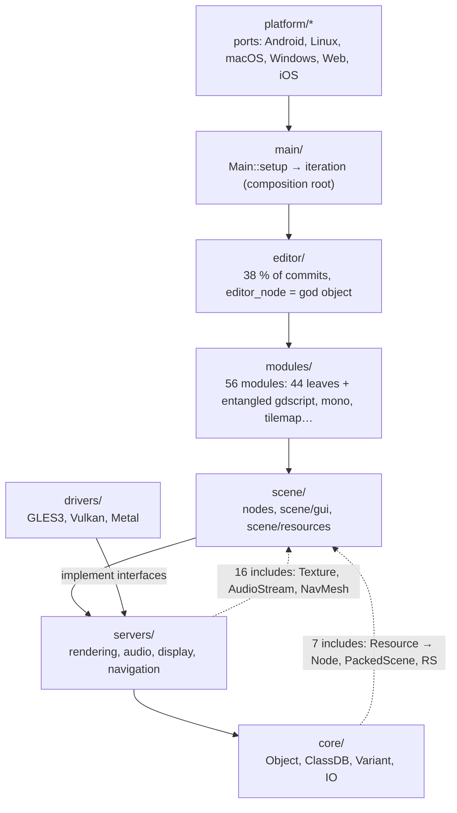

# Repo Map — Godot Engine

> Onboarding document. It shows where the system lives, how it is really coupled, what is dangerous and who to ask.
> Built from three artifacts: **[T]** `artifact-1-territory.md` (git history), **[S]** `artifact-2-structure.md` (include and build graph), **[C]** `artifact-3-contributors.md` (people in `scene/resources`). Raw data is in `evidence/`. The source tables live in the artifacts; this document holds only the conclusions.
> Snapshot: `master` @ `6765a18ca8` (2026-10-22). The time windows differ; see §7.

**How each coupling is known** (tags used throughout):
`[graph]` `#include` graph from cpp-dependencies · `[git]` co-change in history · `[build]` SCons rules · `[text]` heuristic text parser (Java/Kotlin, C#, JS, GLSL) · `[PR]` GitHub discussions · `[no graph]` no tool covered it, so it is **unknown**, not "no coupling".

---

## 1. TL;DR

Godot is a C++ game engine (1.7 M LOC) whose editor is written in the engine itself, plus about 200 k LOC in seven other languages: Java/Kotlin for Android, C#, GLSL, JS for the Web, Python/SCons, GDScript and Swift. The layers follow the boot order in `main/main.cpp`. In practice each layer is one tangled block, and about 24 "backward" includes in game builds close the whole engine into a single cycle. Work concentrates in the **editor** (38 % of commits), the **UI controls** and **rendering**: about 300 meaningful commits a month from 371 authors. It hurts most in four places. Compatibility of saved scenes and resources breaks silently, and someone else fixes it months later. Materials and particles have a series of reverts and zero tests. The two renderers are maintained as hand-kept copies. The scripting-language contract spreads one change across core, GDScript and C#. Tests touch only about 3 % of commits, so you **verify most changes by hand**.

*Arrow = "depends on". Dashed lines are backward dependencies present in game builds `[graph]` `[build]`. They are what turn 101 components into one cycle.*

---

## 2. Territory

### Large responsibility vs periphery

| | Area | Why it is here |
|---|---|---|
| **Core of responsibility** | `core/object` (ClassDB, ScriptLanguage), `core/io` | fan-in of about 120 components; `class_db.h` is included by 797 files across all 9 layers `[graph]` |
| | `scene/resources` | fan-in 73, consumed by servers and core `[graph]` |
| | `servers/rendering` + `drivers/gles3` | both components exceed 20 kLOC; 107 + 69 commits `[graph]` `[git]` |
| | `editor/` root + `scene/gui` | the most commits and the most fixes `[git]` |
| **Periphery (cheap)** | 44 of 59 leaf modules: physics, `openxr`/`webxr`, `text_server_*`, codecs, networking | nothing includes them; they plug in only through `register_types.cpp` `[graph]` |
| | `core/extension` (GDExtension interface) | 10 commits in 6 months, a stable ABI surface `[git]` |
| | 413 editor-only files | never reach game builds `[build]` |

### Deep and shallow modules (interpretation of fan-in/fan-out, not a measurement)

- **Deep** (small interface, a lot of hidden logic): `RenderingServer` (`servers/rendering/rendering_server.h`, 210 includers) hides two renderers. Leaf modules hide whole backends (e.g. Jolt) behind a single `register_types.cpp`.
- **Shallow** (wide interface, everything hooks into it): `editor/editor_node.h`. It has 226 includers from 5 layers, and its folder has the highest fan-out in the repo (50). `scene/resources` is a set of data types used by every layer, so it hides little.

### Where the folders mislead about real activity and boundaries

1. **`scene/resources` lives in `scene/`, but works *below* `servers/`.** Audio, display and navigation include its types without guards `[graph]`. The folder suggests a game layer; in practice it is the shared vocabulary of the whole engine.
2. **`modules/` suggests "plug-ins", but only 44 of 59 are.** `gdscript`, `mono`, `tilemap`, `visual_shader`, `jsonrpc`, `glslang`, `svg`, `zip`, `texture_streaming` and `visionos_xr` sit inside the big cycle `[graph]`.
3. **`scene/gui` is game runtime, but its activity is driven by the editor.** The editor is built from these widgets (`box_container.h` has 115 includers) `[graph]`. There are 76 Editor ↔ Scene co-changes `[git]`.
4. **Export lives in two places:** `editor/export/` and `platform/*/export/`. P(export | iOS) = 0.5 `[git]`, and exporters compile only in editor builds `[build]`.
5. **`doc/classes` has the second-highest commit count (241)**, but that is mostly regeneration, not work in that folder (see §3 and §4b).
6. **Recent moves** (TileMap → `modules/tilemap`, visual shader → module, the `node_3d_editor_*` split) inflate line counts in `editor/scene/*`, `scene/2d` and `modules/tilemap` `[git]`.

### Activity over time

Window 2026-04-22 → 2026-10-22: a steady 240–380 commits a month, peaking in July (378). Git alone shows **no** freeze period; release phases are unknown `[T §3]`. Disclosed AI-agent involvement is about 3.4 % of PRs, with no hot spot of its own. That is a lower bound.

---

## 3. Real couplings

### What actually changes together

Kind: **manual** = someone edits both places (expensive). **Regeneration** = a tool produces the other side (cheap).

| What with what | Strength | How I know | Kind |
|---|---|---|---|
| `drivers/gles3` ↔ `servers/rendering` (Compatibility renderer ↔ RD) | 36 commits, P(RD \| GLES3) = 0.57 | `[git]`. `[graph]`: one SCC once backward edges are removed. `[text]`: 12 duplicated shaders with no shared include | **manual**, 2–3 edits per fix |
| Forward+ ↔ Mobile (`render_forward_clustered.cpp` ↔ `render_forward_mobile.cpp` + twin `.glsl` files) | Jaccard 0.43 / 0.46 | `[git]` | **manual** |
| `script_language.h` ↔ `script_language_extension.h` ↔ `gdscript` ↔ `csharp_script.h` | Jaccard 0.36–0.75 | `[git]`, `[graph]` (`core.object` fan-in = 121) | **manual**; 10 of 16 commits are one refactor series, so the coupling may weaken |
| C++ ↔ C# interop tables (`runtime_interop.cpp` ↔ `NativeFuncs.cs` 226, `editor_internal_calls.cpp` ↔ `Internal.cs` 33, `ManagedCallbacks` 43) | 1:1, **bound by position** | `[text]`; git doesn't show them (low traffic) | **manual and silent**: reordering an entry breaks runtime with no error |
| C++ API → generated C# API (`GodotSharp/Generated`) | every registered class | `modules/mono/editor/bindings_generator.cpp`; the folder is in `.gitignore` | **regeneration**, but its reach and size are `[no graph]` |
| C++ binding ↔ `doc/classes/*.xml` | 252 commits (13.6 %) | `[git]` + CI runs `--doctool` and shows the diff (`.github/workflows/linux_builds.yml:255`) | **regeneration** of the XML skeleton; only the description is written by hand |
| GDScript parser/analyzer ↔ expected `.out` files in `modules/gdscript/tests` | counts unknown | `--gdscript-generate-tests` flag (`modules/gdscript/tests/test_gdscript.cpp:391`) | **regeneration** |
| `.glsl` → `.glsl.gen.h`; `modules_enabled.gen.h`, icons, translations | 84 generated files | `[build]`; `*.gen.*` is in `.gitignore`, so invisible in git | **regeneration by the build** |
| `theme_classic.cpp` ↔ `theme_modern.cpp` | 95 % of classic edits also hit modern, J 0.67 | `[git]` | **manual**; it looks generated, but it isn't |
| `scene/2d` ↔ `scene/3d` (twin nodes), `godot_physics_3d` ↔ `jolt_physics` | P = 0.65 / 0.64 | `[git]` | manual, feature parity |
| `animation_blend_space_1d_editor` ↔ `_2d_editor` | J 0.88 | `[git]` | manual, copy-paste |
| Desktop ports (linuxbsd ↔ windows ↔ macos) | P = 0.2–0.3 | `[git]` | manual, `DisplayServer` parity |
| Java/Kotlin ↔ C++ (JNI) | 77 downcalls, 175 upcalls; `GodotNativeBridge` handles 53 | `[text]`; 28 polymorphic targets and reflection via `java_class_wrapper.cpp` are **unknown** | manual |
| JS (Web) ↔ C++ | 182 Emscripten functions, 59 function-pointer callbacks | `[text]`; callbacks not mapped | manual; `editor_node.cpp`, `filesystem_dock.cpp` and `drivers/gles3` bypass `platform/web` |
| Modules ↔ other modules' thirdparty (theora → libogg, text_server → freetype) | — | `[build]`; the include graph can't see it | build |

### Layers and cycles

- **One SCC: 101 of 164 components, across all layers** `[graph]`. The edge-removal experiment shows that a handful of backward edges hold it together. Removing the 11 edges going out of `core` detaches core. In game builds about 24 such includes remain: core → scene/servers/main (7), servers → scene (16), `drivers/png` → scene (1) `[build]`.
- **Inside a layer, every subfolder reaches every other.** Treat `core`, `scene`, `servers` and `editor` as four monoliths, not as sets of modules.
- **No cycles:** the shader graph, the C# project graph, the Gradle graph (`:lib` imports nothing from `:app`/`:editor`) `[text]`. Java packages in `:lib` and the C# interop core (`Godot ↔ Godot.Bridge ↔ Godot.NativeInterop`) do have internal cycles.

### Where there is no graph (unknown, not "no coupling")

- **C++ runtime**: ClassDB lookups, `Engine::get_singleton()` singletons, signals, `Callable`, GDExtension calls. This is a large part of Godot's real wiring, and no graph shows it.
- **Generated C# API** (gitignored, produced at editor runtime). 19 of 35 `GodotTools` files depend on it.
- **Dependencies of non-shader `*.gen.h`** (221 includes): we know who generates them, not what they include.
- **92 `.inc` files** (7.9 k LOC in `core/math`, `scene/*`): their includes were not classified.
- **`MODULE_*_ENABLED` guards** are not evaluated; the graph is the union of all configurations.
- **Same-package Java/Kotlin and same-namespace C#**: about 40 % of file-level Java coupling is missing from the package graph.

---

## 4. Risk zones

Every zone is backed by at least two independent signals. Signals with a common cause are counted once.

| # | Zone (product) | Where it lives in code | Why (one line) | Signals |
|---|---|---|---|---|
| 1 | **Saving and loading scenes and resources** (compatibility of `.tscn`/`.tres` project files) | `scene/resources/packed_scene.cpp`, `scene/resources/resource_format_text.cpp`, `core/io/resource_format_binary.cpp`, `core/io/resource.cpp` | Changing how a property is stored silently breaks old files, and a different person fixes it months later. | ① fan-in 73 and backward includes from core in game builds `[graph]` `[build]` ② recurring compatibility-fix chains (#92282 → #116331 → #120684 → #119819; AnimationLibrary → #114844) `[git]` `[PR]` ③ no direct tests for `ResourceFormatLoaderText` |
| 2 | **Look of materials, particles and environment** (user-visible default values) | `scene/resources/material.cpp`, `scene/resources/particle_process_material.cpp`, `scene/resources/environment.h` | All 3 reverts of the 12 months and 2 default-value regressions cluster here, and there are no unit tests. | ① reverts #115163, #116140, #118373 and the glow / curve-range regressions `[PR]` ② 0 references in `tests/` (checked) ③ 14 authors, top-1 holds 12 %, ownership exists only through review `[git]` |
| 3 | **Picture on screen across GPUs** (Compatibility renderer vs Forward+/Mobile) | `drivers/gles3/` (`rasterizer_scene_gles3.cpp`), `servers/rendering/renderer_rd/` (`forward_clustered/render_forward_clustered.cpp`, `forward_mobile/render_forward_mobile.cpp`), `drivers/gles3/shaders`, `servers/rendering/renderer_rd/shaders` | Every feature and fix has to be done 2–3 times in hand-kept copies, so they drift apart easily. | ① P = 0.57 and J 0.43 co-change, 44 % fixes, 48 authors `[git]` ② both components > 20 kLOC, 12 duplicated shaders with no shared code `[graph]` `[text]` |
| 4 | **Working in the editor: scene tree, docks, UI controls** | `scene/gui/tree.cpp`, `editor/docks/scene_tree_dock.cpp`, `editor/editor_node.cpp`, `editor/script/script_editor_plugin.cpp` | The least stable code in the repo; a widget fix surfaces in a random place in the editor. | ① `scene/gui` has 47 % fixes, `Tree` 19 fixes out of 26 commits, `scene_tree_dock.cpp` 26 of 48 `[git]` ② `editor_node.h` has 226 includers, `editor` folder fan-out = 50, `scene.gui` fan-in 49 `[graph]`. Fixes in `scene/gui` and in the docks share one cause (editor needs), so they count as one zone. |
| 5 | **Game scripting: GDScript and C#** (language contract, class registry, interop) | `core/object/class_db.h`, `core/object/script_language.h`, `core/object/editor_language.h`, `core/object/script_language_extension.h`, `modules/gdscript/gdscript.h`, `modules/mono/csharp_script.h`, `modules/mono/glue/runtime_interop.cpp` ↔ `modules/mono/glue/GodotSharp/GodotSharp/Core/NativeInterop/NativeFuncs.cs` | One interface change in core forces edits in GDScript and C# at once, and the C# interop tables break without a message. | ① `class_db.h` has 797 includers `[graph]` ② core ↔ gdscript ↔ mono co-change cluster `[git]` ③ position-bound tables `[text]`. The `ScriptLanguage` → `EditorLanguage` and `ClassDB` → `GDType` refactors are in progress. |
| 6 | **Running and exporting on Android** | `platform/android/java/`, `platform/android/java_godot_lib_jni.cpp`, `platform/android/java_godot_wrapper.cpp`, `platform/android/export/export_plugin.cpp` | A second world in Java/Kotlin behind a JNI bridge, maintained by a very small group of people. | ① only 7 Java/Kotlin authors in the window `[git]` ② 77 + 175 JNI calls, 28 polymorphic plus reflection (reach unknown), a cycle across 13 of 19 `:lib` packages `[text]` ③ 34 % fixes in `platform/android` `[git]` |

**Traps below the zone threshold** (only one signal each): hand-kept theme twins `theme_classic` ↔ `theme_modern`; the editor and GLES3 bypassing `platform/web`; Apple export split between `editor/export` and `platform/ios`; dead shaders `drivers/gles3/shaders/{cube_to_dp,effect_blur,lens_distorted}.glsl`; the never-compiled `modules/visual_shader/tests/test_visual_shader.cpp`.

### 4b. Looks dangerous, but isn't

| Signal | Why it is a false alarm |
|---|---|
| One cycle through 101 components | It has one cause: about 24 backward includes. Counted once, in zone 1, not as a separate "architecture to rewrite". |
| 319 modules → editor and 12 scene → editor includes | All are editor-only (`TOOLS_ENABLED`, SCsub `env.editor_build`) and never reach game builds `[build]`. |
| `doc/classes`: 241 commits, the second most active area | It is a workflow enforced by CI (`--doctool`). The XML follows API changes; it is not a separate source of work. |
| Huge churn: `modules/tilemap` +34 k, `editor/scene/2d` −17 k, `modules/visual_shader` +5.7 k, `node_3d_editor_viewport.cpp` about 8 k | Code moves, not new logic. `scene/resources` shows −6.6 k lines for the same reason. |
| Mass commits: mbedTLS (515 files), SDL, HarfBuzz, `Style:` and `RETURN_IF_ERROR` sweeps | Vendored thirdparty and formatting; filtered out of the rankings `[T §1–2]`. |
| `core/object`: 57 commits | A planned refactor with 16 % fixes. The risk is reach, not instability; already counted in zone 5. |
| `main/main.cpp`: 28 commits, fan-out 46 | The composition root: every feature registers here. Only 4 commits are fixes. |
| `cpp-dependencies`: test headers in `modules/*/tests` reported as "never used" | A tool artifact: generated test registration pulls them in. |
| Translation sync, `*.po`, `misc/extension_api_validation/**` | The Weblate pipeline and API validation data, i.e. changes by regeneration. |
| CI and `bin/` | 22 housekeeping/CI commits with no visible trial-and-error series. Build outputs (`bin`, `*.gen.*`) are in `.gitignore`, so the history has no `dist`-style artifacts. |
| PRs with AI involvement | 3.4 % of PRs, spread the same way as human work, with no hot spot of their own. |

---

## 5. Who to ask

`[C]` = measured in artifact 3 (commits + approvals, 12 months, `scene/resources` only). `[shortlog]` = a quick `git shortlog --no-merges` over the zone's paths in the 6-month window. I ran it while writing the map, because the artifacts did not measure people outside `scene/resources`. It is an early authorship signal, not confirmed expertise.

| Zone | First contact | Backup | Source |
|---|---|---|---|
| 1. Saving/loading scenes | KoBeWi (`.tscn` format, `PackedScene`) | Rindbee (local-to-scene, inherited scenes) | `[C]` |
| 2. Materials, particles, environment | clayjohn (materials, rendering defaults) | QbieShay (particles; **bus factor**: writes 60 % and approves it) | `[C]` |
| 3. Two renderers | Skyth (23 commits in `gles3` + `renderer_rd`) | Clay John (11) | `[shortlog]` |
| 4. Editor and UI | KoBeWi (21 of 69 commits on `editor_node.cpp` `[T]`; 66 in the zone) | YeldhamDev (36) | `[T]` + `[shortlog]` |
| 5. GDScript/C# scripting | HolonProduction (`EditorLanguage` series; 10 of 16 commits on `script_language.h`) | Raul Santos (C#; attach ordering in `instantiate()`) | `[T]` + `[C]` + `[shortlog]` |
| 6. Android | Fredia Huya-Kouadio (28) | Anish Kumar (23) | `[shortlog]` |

For questions about structure (includes, module boundaries, core types): Ivorforce and akien-mga `[C]`. Ask them about structure, not about resource behaviour.

---

## 6. First day

The order goes from the backbone to the risk zones.

1. **`main/main.cpp`**: `Main::setup` (:984) → `setup2` (:3123) → `start` (:4050) → `iteration` (:4961). Shows the real layer order and the composition root.
2. **`core/object/class_db.h`**: the class and binding registry, the most central header (797 includers). Everything becomes visible to scripts and the editor through it.
3. **`modules/jolt_physics/register_types.cpp`**: the pattern of a clean leaf module plugging in at the initialization levels. This is what a "cheap" change looks like.
4. **`servers/rendering/rendering_server.h`**, then a look at the structure of `drivers/gles3/` vs `servers/rendering/renderer_rd/`. One API with two hand-kept implementations underneath (zone 3).
5. **`core/io/resource_format_binary.cpp`** (include at :42) and **`scene/resources/packed_scene.cpp`**: the core → scene backward edge and the heart of serialization (zone 1). Add PRs #121920, #114844 and #103352.
6. **`core/object/script_language.h`** + **`core/object/editor_language.h`**: the scripting-language contract under refactor (zone 5).
7. **`editor/editor_node.h`** (skim only), then **`scene/gui/tree.cpp`**: the editor hub and the least stable widget (zone 4).

Before your first change in materials or particles, read the reverts #115163, #118373 and #116140, and the #110077 → #112471 regression (zone 2).

---

## 7. Limitations

- **The time windows are not equal.** Activity history `[T]` covers **6 months** (2026-04-22 → 2026-10-22). A full **year** (2025-10-22 → 2026-10-22) is covered only by the people analysis `[C]`, and only for `scene/resources`. The graph `[S]` is a HEAD snapshot with no window. This is a map of **activity and structure** in those windows, not a description of code quality or of the project's history.
- **Method.** Fixes are detected from the commit subject only, so reverts and fixes titled "Improve…" carry no separate weight. The graph is textual and blind to the preprocessor; guards were classified by a simple parser. Languages other than C++ were covered by heuristic scripts, not compilers. Commits ≈ PRs (squash).
- **What this map does NOT tell you:**
  - how things are coupled at runtime (ClassDB, signals, singletons): `[no graph]`;
  - who the experts are outside `scene/resources`: §5 for zones 3–6 is authorship only, and approvals can't tell deep review from a release manager's sign-off;
  - what is in flight right now: open PRs were not collected (e.g. #101456, tracker #111218);
  - what happens on release branches (`4.x`, `3.x` backports);
  - the reach of the generated C# API and of non-shader `*.gen.h`;
  - how much undisclosed AI use there was (3.4 % is a lower bound);
  - performance, correctness and test coverage beyond the gaps checked in zones 1–2;
  - people's status and availability (team membership, timezone).
- **Checked while writing:** every path in §4 and §6 exists at HEAD. The line numbers in `main/main.cpp` and `core/io/resource_format_binary.cpp` match. The CI `--doctool` step and the `--gdscript-generate-tests` flag exist. `*.gen.*` and `bin` are in `.gitignore`.
